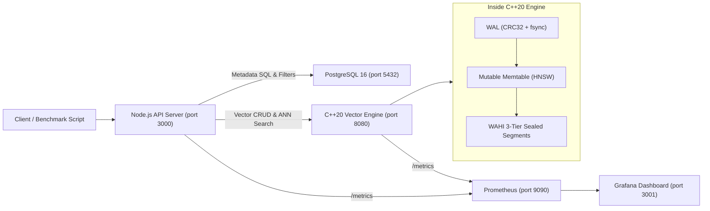
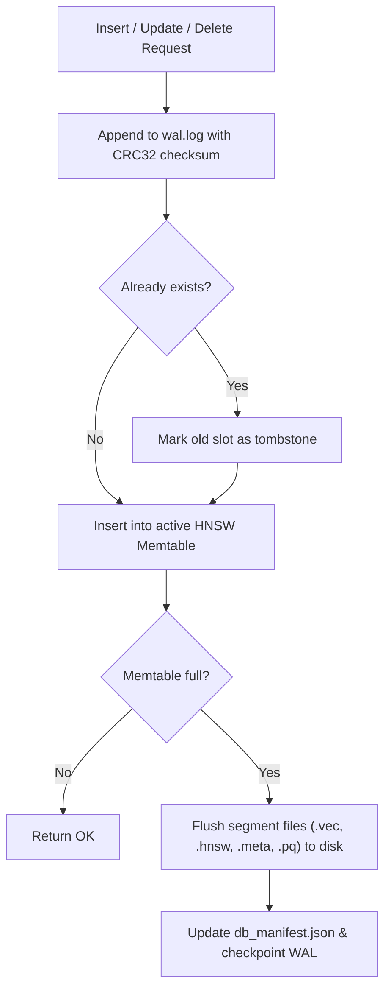
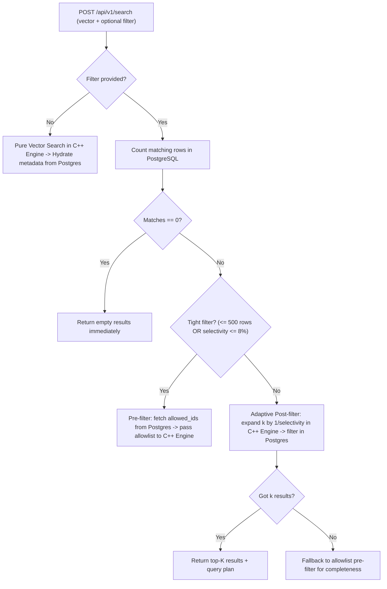
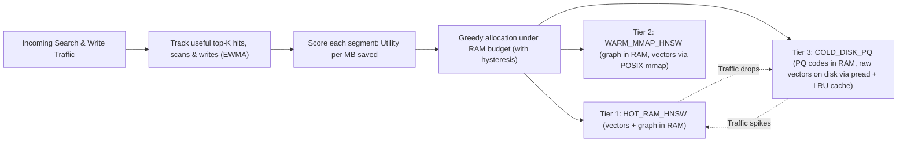

# Adaptive Vector Database Engine

I built this project to solve a problem most basic vector search demos skip: what happens when your embedding dataset gets larger than RAM, keeps changing with inserts, updates, and deletes, and needs SQL metadata filtering at the same time?

Instead of wrapping an existing vector database, I wrote the core storage and indexing engine from scratch in **C++20**, built a **Node.js** API + query optimizer in front of it, backed metadata with **PostgreSQL**, added **Prometheus + Grafana** monitoring, and containerized everything with **Docker Compose**.

---

## The Problem I Wanted to Solve

If you put 100M vectors in memory with HNSW, search is fast, but RAM gets expensive very quickly. If you compress everything to disk, RAM stays small, but recall drops and disk reads slow queries down.

In real applications, traffic is uneven:
- A small slice of vectors gets searched heavily right now, while older vectors sit cold.
- Hot topics shift over time.
- Records get updated or deleted continuously.
- Users filter by attributes (`category`, `price`, `tags`, JSON fields) alongside vector similarity.

My goal was to test a simple idea I call **Workload-Adaptive Hybrid Indexing (WAHI)**: watch which segments actually answer queries, keep hot segments in fast RAM HNSW, move medium segments to `mmap`-backed HNSW, and compress cold segments on disk with Product Quantization (PQ), adapting automatically as traffic moves.

---

## How Everything Connects (Big Picture Flow)



---

## Step-by-Step Flows

### 1. How a Write & Crash Recovery Works

Every insert, update, or delete hits the Write-Ahead Log before touching memory, so even a hard `SIGKILL` crash recovers cleanly.



On restart after a crash:
1. The engine reads `db_manifest.json` and reloads sealed disk segments.
2. It replays `wal.log` for any operations newer than the last checkpoint.
3. If a crash left half-written bytes at the tail of `wal.log`, the CRC32 check catches it and truncates cleanly back to the last valid record.

---

### 2. How Hybrid Search Works (Vector + PostgreSQL Metadata)

Combining vector search with SQL filters (`WHERE category = ... AND price <= ...`) fails if you always use one rigid strategy. The Node.js query optimizer (`api/src/optimizer/queryOptimizer.js`) checks filter selectivity in PostgreSQL first and picks the cheaper execution path:



---

### 3. How WAHI Adapts Storage Tiers at Runtime

Static systems like DiskANN/Vamana (SSD graph + in-RAM PQ) or SPANN (disk posting lists + RAM head index) keep the same layout regardless of traffic shifts. In my engine, sealed segments move dynamically across three tiers under a hard RAM budget:



One key thing I learned while testing this: counting how often a segment is *scanned* does not work well when pure vector queries fan out across every segment, because every segment ends up looking equally hot. Tracking **useful hits** (which segments actually produced the final global top-K results) gives a clean signal of where the real hotspot lives.

---

## Project Layout

- [`engine/`](engine/) — C++20 core engine: distance math (`distance.cpp`), brute force (`brute_force.cpp`), HNSW (`hnsw.cpp`), Product Quantization (`pq.cpp`), WAL (`wal.cpp`), `mmap` & LRU disk cache (`mmap_storage.cpp`), segments (`segment.cpp`), WAHI controller (`wahi_controller.cpp`), HTTP/metrics server (`server_main.cpp`), GoogleTests, and benchmarks.
- [`api/`](api/) — Node.js Express server, PostgreSQL schema & batch `UNNEST` queries (`postgres.js`), selectivity-aware hybrid query optimizer (`queryOptimizer.js`), and `node --test` unit tests.
- [`observability/`](observability/) — Prometheus scrape config and pre-built Grafana dashboard JSON.
- [`benchmarks/`](benchmarks/) — Python end-to-end Docker benchmark (`run_benchmarks.py`), `SIGKILL` crash-recovery + concurrency stress test (`crash_recovery_test.py`), and saved JSON results.
- [`docker-compose.yml`](docker-compose.yml) — Spins up PostgreSQL, the C++20 engine (`mem_limit: 512m`), Node.js API, Prometheus, and Grafana together.

---

## What the Benchmarks Showed

All tests and benchmarks were run inside Docker (`Ubuntu 24.04`, `g++ 13.3.0 -O3 -std=c++20`, `Node 20`, `PostgreSQL 16`).

### Unit & Concurrency Tests
- **C++20 engine (`ctest`)**: `6/6` suites passed (`test_distance_and_bf`, `test_hnsw`, `test_wal_and_mmap`, `test_pq`, `test_wahi`, `test_concurrency`).
- **Node.js API (`node --test`)**: `3/3` tests passed (SQL filter builder, tight pre-filter plan, broad adaptive post-filter plan).

### Core Algorithm Comparison (`18,000` vectors, `128d`, `60` clusters, Cosine)

| Index | Recall@10 | p50 (ms) | p95 (ms) | QPS | RAM |
|---|---:|---:|---:|---:|---:|
| BruteForce | 1.0000 | 1.742 | 2.326 | 555.4 | 17.02 MB |
| HNSW (`ef=32`) | 0.9633 | 0.069 | 0.123 | 12,949.1 | 21.28 MB |
| HNSW (`ef=64`) | 0.9660 | 0.080 | 0.131 | 11,101.3 | 21.28 MB |
| HNSW (`ef=128`) | 0.9667 | 0.102 | 0.138 | 9,157.9 | 21.28 MB |
| PQ (`ADC only`) | 0.2273 | 0.386 | 0.537 | 2,430.0 | 0.67 MB |
| PQ (`ExactRerank 8x`) | 0.7560 | 0.446 | 0.715 | 2,080.2 | 0.67 MB |

### Skewed 85/15 Workload Under Tight RAM (`5.18 MB` cap across 12 segments)

| Policy | Recall@10 | p95 (ms) | QPS | RAM Used | Tiers (Hot / Warm / Cold) | Disk Reads |
|---|---:|---:|---:|---:|---:|---:|
| `static_all_ram` (no cap) | 0.9999 | 1.258 | 1,110.9 | 16.27 MB | 12 / 0 / 0 | 0 |
| `static_all_disk_pq` | 0.6594 | 2.275 | 631.0 | 1.91 MB | 0 / 0 / 12 | 503,614 |
| `static_lru` (hit-recency) | 0.8232 | 1.653 | 730.2 | 4.53 MB | 3 / 0 / 9 | 377,520 |
| **`wahi_adaptive` (mine)** | **0.9544** | **1.194** | **985.9** | **5.12 MB** | **3 / 4 / 5** | **217,101** |

With ~68% less RAM than `static_all_ram`, WAHI kept **0.9544 Recall@10** and cut disk reads by **42.5%** compared to LRU by keeping the 3 hottest segments in RAM HNSW, 4 warm segments in `mmap` HNSW, and 5 cold segments in PQ on disk.

### Shifting Hotspot Workload (3 Epochs Under `5.18 MB` cap)

| Policy | Overall Recall@10 | Adapted Recall (Ep 1 / 2 / 3) | p95 (ms) | Promotions / Demotions | Disk Reads |
|---|---:|---:|---:|---:|---:|
| `static_all_disk_pq` | 0.6153 | 0.6924 / 0.5844 / 0.5560 | 2.301 | 0 / 12 | 943,544 |
| `static_lru` | 0.9161 | 0.9320 / 0.9476 / 0.9604 | 1.576 | 32 / 41 | 707,015 |
| **`wahi_adaptive` (mine)** | **0.9465** | **0.9551 / 0.9644 / 0.9764** | **1.820** | **26 / 34** | **410,993** |

### End-to-End Docker Stack & Crash Recovery
- Ingested **4,000 vectors + PostgreSQL metadata** through the Node.js batch endpoint in **2.556s** (`1,564.9 vec/s`).
- Hybrid optimizer picked `prefilter_allowlist` at **0.75%** selectivity (`26.16 ms`) and `adaptive_postfilter` at **48.18%** selectivity (`5.40 ms`).
- Killed `vectordb-engine` with `SIGKILL` while unsealed inserts and a delete were only in the WAL; after container restart, all live records and the delete replayed cleanly with zero data loss.

---

## How to Run and Check Everything

### 1. Start the full stack

```bash
docker compose up -d --build
```

### 2. Run the unit tests

In PowerShell (Windows):

```powershell
docker exec vectordb-engine sh -c 'for t in /app/tests/test_*; do "$t" || exit 1; done'
docker exec vectordb-api node --test tests/api.test.js
```

### 3. Run the end-to-end benchmark & crash-recovery test

```bash
docker compose --profile bench run --rm benchmark
python benchmarks/crash_recovery_test.py
```

### 4. Inspect live dashboards and endpoints

- **Grafana WAHI Dashboard**: http://localhost:3001/d/wahi-vectordb-overview/adaptive-vectordb-wahi-telemetry (viewer access enabled; admin login `admin` / `admin`)
- **Prometheus Targets**: http://localhost:9090/targets
- **Node.js API**: http://localhost:3000/health | http://localhost:3000/api/v1/stats | http://localhost:3000/metrics
- **C++20 Engine**: http://localhost:8080/health | http://localhost:8080/v1/stats | http://localhost:8080/metrics
